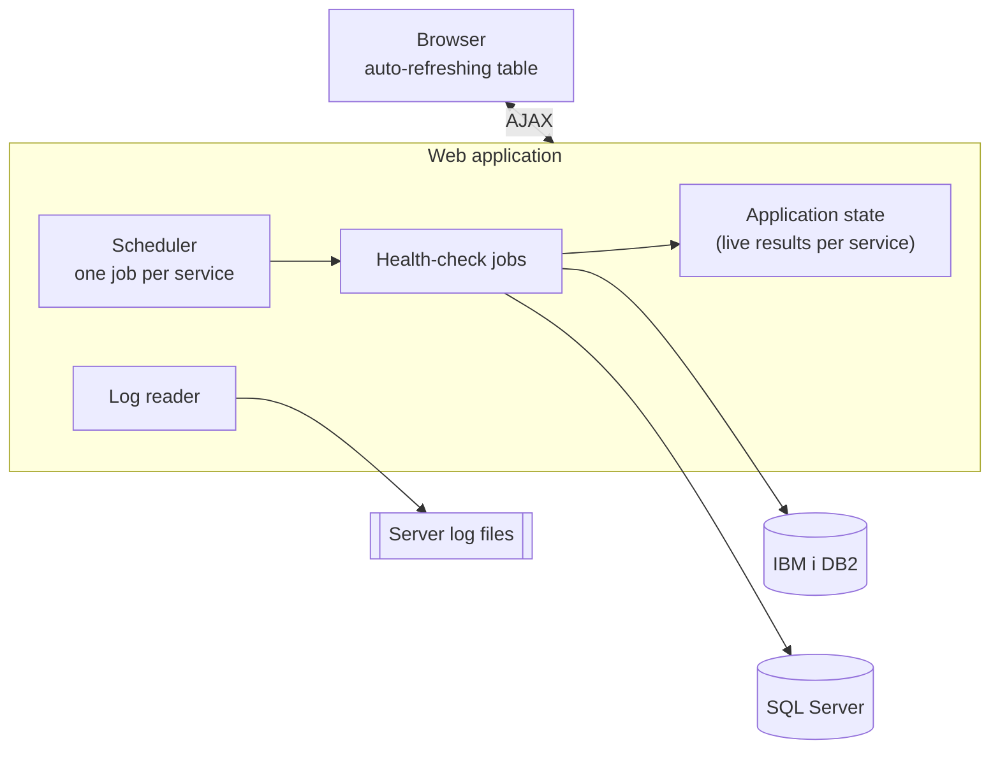

# Service Health Dashboard

**A real-time operations dashboard that monitors the transaction health of many payment services from one screen, with configurable health checks, threshold alerting and in-browser log viewing.**

> **About this repository**
> This project was built in a professional setting and its source code is the property of my employer. This repository is a **portfolio write-up only**: it contains no source code, no configuration and no internal system details. Names, figures and workflows are described at a general level.

---

## Overview

Operations teams in a payments business need to know, at any moment, whether transactions are flowing through each backend service, whether failures or stuck transactions are building up, and whether the background jobs behind each service are still running.

Before this dashboard, that meant running ad-hoc database queries across several platforms and often discovering problems late. I designed and built a **single live web dashboard** that checks every service automatically, highlights anything unhealthy, and lets operators investigate without leaving the browser.

## My Role

- Designed and built the application end to end: scheduling engine, data access, alerting logic and user interface.
- Integrated two database platforms (IBM i DB2 and Microsoft SQL Server) behind one monitoring model.
- Built a remote log viewer for very large server log files.
- Re-targeted the application to an older Java and servlet level so it could run on the organisation's existing application server.

## Key Features

**Monitoring**
- Each monitored service has its own scheduled health check with its own polling interval.
- Results are classified into pending, successful and failed transactions, with the time of the latest transaction.
- Optional job-liveness check per service (running or down).
- Checks are routed to the correct database platform automatically.

**Alerting**
- **Critical (red)** when failures or pending transactions exceed a threshold, or when no transaction has arrived within a configured time window.
- **Warning (yellow)** when the service's background job is down.
- Unhealthy services are always pinned to the top of the table; sorting applies only to healthy rows.

**Operations**
- **Configuration-driven:** services and thresholds are defined as data, so adding or re-tuning a service needs no code change and no redeployment.
- **Hot reload:** a refresh action re-reads the configuration and reschedules only what changed, while the application keeps running.
- **Run Now** to trigger any check on demand.
- **In-browser log viewer** showing the tail of a service's log file on the server, including very large, gigabyte-scale files.

**User experience**
- Auto-refresh every few seconds, paused automatically while a dialog is open.
- Live search, column chooser, sortable headers, pagination, and switchable light and dark themes.

## Tech Stack

| Area | Technology |
|---|---|
| Language | Java 8 |
| Web | JSF 2.2 (Facelets), PrimeFaces, PrimeFlex |
| Scheduling | Quartz Scheduler |
| Application server | IBM WebSphere |
| Databases | IBM i (AS/400) DB2, Microsoft SQL Server |
| Data access | JDBC with container-managed connection pools |
| IBM i services | System SQL services and QShell for server-side file access |

## Architecture

The design follows a layered MVC structure: presentation beans, a model that evaluates alert rules per service, a data-access layer for both databases and log files, and a scheduling service that owns job lifecycle.

## Engineering Highlights

- **Diff-based rescheduling.** On reload, the scheduler removes jobs for deleted services, recreates changed ones and adds new ones, without a restart. Along the way I diagnosed and worked around a scheduler behaviour that silently dropped triggers when jobs were replaced.
- **Thread safety between worker and request threads.** Background jobs update shared state while web requests read it; atomic reference swaps, volatile counters and synchronized updates keep the view consistent.
- **Resilient by design.** A failing query never stops a schedule: errors are logged, results fall back to safe defaults, and a broken liveness query cannot raise a false "down" alert.
- **Time-zone-correct staleness detection.** Timestamps are read and compared in a consistent reference frame, removing off-by-hours false alarms.
- **Constant-memory log tailing.** Small files are read directly; large files are tailed on the server so only the last few thousand lines cross the network, avoiding memory exhaustion and timeouts.
- **Schema-tolerant checks.** Optional result columns are detected at runtime, so existing health checks keep working as new ones gain richer data.
- **Legacy platform compatibility.** Down-levelled the application to Java 8 and an older servlet specification while keeping a modern UI component library.

## Impact

- Replaced manual, multi-database checks with one live view across all monitored services.
- Problems surface within seconds and are visually prioritised, rather than being found after customer complaints.
- Reading production logs no longer requires terminal access or file transfers.

## Skills Demonstrated

`Java` · `JSF / PrimeFaces` · `Quartz Scheduler` · `IBM WebSphere` · `IBM i / AS/400` · `DB2` · `SQL Server` · `JDBC` · `Connection pooling` · `Concurrency` · `Real-time monitoring` · `Alerting` · `Observability` · `MVC` · `Payments domain`

---

**Sarim Nadeem** · MSc Computer Science · [LinkedIn](https://www.linkedin.com/in/msarimnadeem) · [GitHub](https://github.com/Sarim375)

*Source code is proprietary and not available. Happy to discuss the design and engineering decisions in an interview.*
